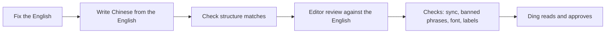
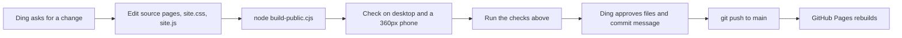

# Maintaining Ding's working notes

Notes for anyone, person or agent, who maintains this site. They record what was decided while building it and why, so later changes stay consistent. `README.md` covers the files, the build and deployment; this file covers everything else.

This repository is public. Keep anything personal or confidential out of it, including out of this file. Content rules that can't be public live in the owner's private notes (`MyCareer/second-me/working-notes-private.md` on Ding's machine). Read them before writing about work, employers or personal life, and ask Ding when unsure.

## What the site is

- A personal site by Wong Ding Zhe, a business intelligence analyst, for a general audience: people new to business analysis or to AI, and colleagues who want to borrow a method.
- Four parts: Home, the business analysis playbook (a scroll story), Using AI (a hub page plus six chapter pages) and Reading.
- It describes how Ding works. It doesn't address hiring managers or sell anything.
- The playbook starts from work Ding owns: KPIs, requests from other teams and team initiatives, run as one plan, do, check, act loop.

## Content rules

- Every example uses a made-up café chain or an everyday scenario. All figures are illustrative, and the site says so once ("All figures on this site are illustrative").
- No employer names, internal system or table names, vendor names, colleague names or real results. Never invent impact numbers.
- Don't add notes saying that names or systems were left out. The site simply doesn't contain them.
- Facts about AI products, models and history need a source in the chapter's Sources list. Products change quickly, so anything tool-specific carries a date ("as of November 2026").
- Ding's own experience is credited as the last Sources item: "My own practice, as of November 2026."
- Book notes are in Ding's voice, written as a reaction after reading. They stay modest: what the book gave Ding, with no hype. Ding approves each new note before it goes in.

## Writing

- British spelling (organise, colour, analyse), sentence case for headings, plain words.
- Every heading states its message ("Speed pays off only when it turns into value"), never a topic label ("Value").
- First person singular for Ding's practice ("I"), second person for advice to the reader ("you").
- Explain jargon on first use, in a clause or a glossary line. Chapter 1 must work for someone who has never used an AI chat app.
- Avoid AI writing patterns, using the humanizer skill's rules:
  - no "not X but Y" contrasts;
  - no em or en dashes in prose;
  - no staged openers ("Here's the thing", "Let's dive in");
  - no one-line closers that restate the paragraph;
  - no forced groups of three;
  - no inflated words (crucial, pivotal, robust, showcase, landscape).
- Calm tone. Ding's speed-versus-value view is written to inform, not to alarm.
- Low profile. Write as someone sharing what works for them, not as an authority: "in my experience", "I find", "a good way to start". No promises about the reader's results ("this will help you", "you will"), no sweeping claims (everyone, always, the best, most business work), no headings that guarantee outcomes. The site's own process rules ("nothing gets interpreted until every check passes") are fine as descriptions of Ding's practice. Readers are invited to get in touch and compare notes.
- Chinese: 数据 for data in general (看数据、示意数据、跟踪数据), 数字 only for a specific figure (这个数字对不对).
- Self-check questions state their whole setup, so they can be answered without scrolling back.

### Ding's review notes (English)

Rules that came out of Ding's reviews. Apply them to every new or changed sentence; the examples show the kind of thing that was rejected.

- **Standard wording, not clever wording.** Use the collocation a careful reader expects.
  - "get work from AI you can trust" → "work with AI to produce results I can trust"
  - "compare notes" (an idiom that reads as a pun on a site called working notes) → "exchange ideas"
- **Avoid regional or informal terms and idioms a reader in Malaysia or China may not know.** "rota" → "shift schedule"; "dearer" → "more expensive"; "pay back" → "pay off" or "be worth it"; "at every turn" → "at every stage"; "a way out" (of a loop) → "a stopping rule"; "doesn't land" → "isn't clear"; "sense-check" → "check that it makes sense"; "catch-up" → "short meeting".
- **Say exactly who does what, when.** "puts lunch cover back, with one barista on delivery orders" → "moves one barista per shop back to the lunch shift, 11am to 2pm, to handle delivery-app orders only".
- **Headings about data or results use reporting terms.** "orders are coming back" → "orders start to recover"; "1.9k down on last year" → "1.9k below the same weeks last year".
- **Low profile** (see the bullet above): share what works for Ding; no promises to the reader, no sweeping claims, no outcome guarantees in headings.
- **The text must match what the reader can see.** A sentence saying the drop was "normal swing" was rejected because the chart shows a steady decline. Check every claim against its chart.
- **Don't invent Ding's practice.** When a story needs a step Ding hasn't described (what happens after a weekly dip, what the fix was), propose it and ask before writing it.
- **Examples from Ding's field.** Use analysis, reporting and business examples (an analyst drafting SQL for a weekly report), not unrelated roles (a Power BI trainer).
- **No counts that go stale.** Don't write "fourteen books" or "six chapters" in running text.
- **Gender-neutral.** Use they/them for Ding and for authors whose gender isn't stated.

## Layout

### Every page

- Top bar: the site's name, "Ding's working notes", on the left (linking home), the four parts on the right. The site is named after the notes, not the person; there's no About page because the home intro already says who Ding is.
- Page head: a page name in the accent colour, a large light-weight `h1`, a lede, and often a line drawing beside them (`page-head with-figure`).
- At the bottom: a `next-page` nav (previous page on the left, next page on the right, same order as the top menu), then the footer: "By Wong Ding Zhe" with email and LinkedIn links (the only place the full name appears), and a version line.
- Content width at most 1140px. Text columns stay under about 70 characters a line.
- Phones: 16px side gutters, no sideways scrolling at 360px wide.

### Home

- An intro beside a field of small line drawings that draws itself in once.
- "What's here": three cards, one per part. The cards have no status labels.

### Playbook

- A scroll story: steps on the left, a sticky canvas on the right whose drawings assemble as you scroll. The pattern is modelled on Stitch Fix's Algorithms Tour (see References); start there when building another story like it.
- On phones the drawing sits at the top and the step text in a fixed box below it. `fitPhoneLayout` in `site.js` measures the tallest step card on each phone and sets `--stage-h`, so the box fits every phone. Scenes scale with `transform: scale()`; zoom made them reflow.
- The loop starts with Plan at the top left and runs clockwise.

### Using AI hub (`ai.html`)

- Collaborator figure in the head.
- Prose sections use `sub split`: on screens 1000px and wider the heading sits in a sticky left column with the text beside it, so wide screens don't look empty.
- The six chapter cards have icons and titles only.
- The tools section is a set of task cards (`.toolkit`, CSS columns) and starts by saying the list is curated from Ding's own research and experience.

### Using AI chapters (`ai-*.html`)

The layout follows what established learning sites do (see References). In order, each chapter has:

1. A page head with an opening drawing and a reading time ("About 10 minutes to read", words ÷ 200).
2. Key ideas first (`.key-ideas`), as a short summary.
3. A contents list (`nav.guide-nav#guide-contents`) of all chapters, with this chapter's sections opened. The section labels match the headings word for word, and the current section is highlighted as you read. On phones the list moves above the text and a floating Contents button (`a.to-contents`) jumps back to it.
4. The text (`article.prose`) with three kinds of box:
   - `.box.practice` for Ding's own practice;
   - `.box.trap` for a common trap;
   - `.box.try` for an exercise.
5. "Check your understanding": tap-an-answer questions (`.quiz`).
6. Sources, numbered in reading order.

### Reading

- A head whose title states the message ("Books teach what work rarely does"), a short note to readers on why and how to read, addressed to "you" like the Using AI hub, and a loop drawing: read, relate, apply, reflect, then read again if needed.
- Then "The books I read" (`.shelf-intro`) with the group links.
- Group links (`.shelf-index`), then four groups of books.
- Each book shows its cover, full title, authors, first year and the edition shown ("1989; 30th anniversary edition, 2020") and Ding's note.
- Covers use the latest edition, resized to about 350px wide.

## Chinese version

- Every page has a Simplified Chinese twin in `zh/` with the same file name (mainland terms, `lang="zh-CN"`). The top menu ends with a language switch (中文 on English pages, English on Chinese pages) that opens the same page in the other language.
- **Change both languages together.** A content change to an English page isn't finished until its `zh/` twin says the same thing, and the other way round.
- Chinese pages link one folder up for shared files (`../site.css`, `../site.js`, `../icons.svg#…`, `../covers/…`); links between Chinese pages stay inside `zh/`.
- Text drawn by `site.js` comes in both languages through `say('English', '中文')`, chosen by the page's `lang`. Any new label in the script needs both.
- Writing: **follow `docs/zh-style-guide.md`.** Write as a mainland analyst would write in Chinese, not as a translation: 刘润's structure (short sentences, one point per section, point first) in 数字生命卡兹克's plain first-person voice, without slang. Say exactly what the English says, sentence by sentence; add and drop nothing. Avoid AI tone with the humanize-chinese skill (no 首先…其次…最后, 值得注意的是, 综上所述, 赋能, 闭环, 抓手). Half-width space between Chinese and Latin letters or digits; full-width punctuation; no em dashes.
- Terms follow how Chinese AI media and workplaces actually write them (checked against 量子位 and 机器之心): Agent stays in English (first mention per page Agent（智能体）), Token, Skill, MCP and Harness stay English; 提示词, 上下文, 幻觉, 评测, 榜单, 电脑操控, 多模态, AI 聊天工具. Business terms: 效率 (productivity), 业务方, 需求, 专项, 看板, 口径, 负责人, 结果 vs 产出. Site name 定泽的工作笔记; author 黄定泽 (no English name on Chinese pages). The full table is in `docs/zh-style-guide.md`.
- Before committing, run `python tools/check-translations.py`: it fails when a Chinese page's structure drifts from its English twin (a paragraph, id, citation or link added on one side only).
- Font: Chinese pages use Noto Sans SC (Source Han Sans, made to match Source Sans), self-hosted in `fonts/` because Google Fonts is blocked in mainland China. It's trimmed to the characters in use: **after changing Chinese text, rerun `tools/subset-zh-font.py`** (see `README.md`), or new characters fall back to system fonts.
- Typography: `html:lang(zh)` in `site.css` puts Noto Sans SC and then Chinese system fonts after Source Sans, turns off italics and negative letter spacing, and loosens line height.

### How to translate or update the Chinese

The method used for the November 2026 rewrite, which Ding found much better than a straight translation. Reuse it for any new or changed Chinese text.

1. **Fix the English first.** Check the English page for logic (claims supported, no contradictions between pages, numbers add up, self-checks have one best answer). The Chinese is written from the final English, never from an older version.
2. **Write the Chinese from the English, sentence by sentence**, following `docs/zh-style-guide.md`: say exactly what the English says (same facts, numbers and qualifiers, nothing added or dropped), in the way a mainland analyst would write it. Rewrite from the meaning; don't adjust the old Chinese word by word.
3. **Keep the structure identical**: the same paragraphs, list items, headings and table cells as the English, so `python tools/check-translations.py` passes. Split long sentences inside a block instead of adding blocks.
4. **Editor review**: go through the Chinese again with the English beside it, block by block, as described at the end of `docs/zh-style-guide.md` (meaning, translationese, word choice, terms, flow). With agents, use a different agent from the writer.
5. **Run the checks**: `tools/check-translations.py`, a scan for the banned phrases in the style guide, and `tools/subset-zh-font.py` if new characters were added. Check drawing labels still fit, on a 360px-wide phone too.
6. **Ding reads the result** before it's committed, especially headings and first paragraphs.

## Visual system

- **Look:** an airy white page with thin line drawings. Dark mode follows the reader's system setting. All colours are tokens on `:root` in `site.css`, redefined for dark mode.
- **Type:**
  - Source Sans 3 for everything;
  - Source Serif 4 italic for handwritten-style notes in drawings and asides (`--font-note`);
  - Source Code Pro for SQL.
- **Colour, one meaning each** (from IBCS):
  - accent blue = the current thing or a link;
  - amber = "look here";
  - green and red = growth and fall only.
  
  Don't use colour for decoration.
- **Drawings:**
  - Inline SVG built from the `icons.svg` sprite. Strokes use `currentColor`, so they follow the theme.
  - Opening drawings draw in once on load (`.onload`, staggered with `--i`). Everything else is static: the review loop in chapter 3 and the pipeline in chapter 6 were made static on purpose.
  - Labels inside drawings use `aria-label` on the SVG, not `<title>`, so no hover tooltips appear.
  - Labels must not touch lines. Check with `getBBox()` overlap tests after any change.
- **Charts:** simple and labelled directly at the line ends, with no legends. Charts of opinion say so in the caption ("My view, as an illustration rather than measured data").
- **Self-checks:** marked with ✓ and ✗ text, not colour alone. Without JavaScript the answer and explanation show as plain text.
- **Motion:** respects `prefers-reduced-motion`. No scroll-triggered fade-ins on sections.

## Markup conventions

- **Citations:** `<a class="cite" href="#src-N" aria-label="Source N">N</a>`. Numbers follow reading order, and each number matches an `id="src-N"` item in Sources. They were audited and renumbered with a throwaway script; write a similar check if you add or move many.
- **Quiz:**
  - `.quiz[data-answer]` contains `.quiz-q`, then `ul.quiz-options` with `button.quiz-option[data-option]`, then `.quiz-result` and `.quiz-why`.
  - The script adds `is-ready` and `is-answered`.
- **Tools cards:**
  - Structure: `.tool-group > dl > div > dt` (the task) and `dd` (one or more `.tool-opt`).
  - Each `.tool-opt` holds a bold tool name with "where to use it, model" underneath.
  - Alternatives are separated by `.tool-or`.
  - Chinese names are written as "Doubao (豆包)".
- **Pages:** source pages link to each other with `.html`. The build rewrites the links to clean addresses.
- **Version line:** each page's footer has a version line ("Version 0.9, 7 November 2026"). Bump that page's version and date when its content changes.

## Tech

- Plain HTML, CSS and JavaScript. No framework and no packages. Node.js runs `build-public.cjs`.
- **Build:**
  - The home source (`data-analytics-playbook.html`) has no `<head>`; the build wraps it.
  - The build adds a description per page (the `DESCRIPTIONS` map), rewrites links to clean addresses, and fingerprints `site.css`, `site.js` and `icons.svg` by content hash, so phones never pair a new page with an old stylesheet.
  - A new page needs to be added to `PAGES` and to `DESCRIPTIONS` (and `ZH_DESCRIPTIONS` for its Chinese twin).
- **Deploy:** push to `main`; GitHub Pages builds and publishes. It is the only host: an EdgeOne Pages copy was removed in November 2026 because its free `edgeone.dev` address returned 4XX errors to mainland China visitors (89 of 92 test points on boce.com), while GitHub Pages loaded from most of them. Don't add another overseas host without testing it from China first. If GitHub Pages fails with "Deployment failed, try again later", start a fresh run (`gh workflow run`); rerunning only the failed job causes a duplicate-artifact error.
- **Local preview:** any server that maps `/ai` to `ai.html` (see `README.md`).
- **Testing quirks:**
  - Background browser tabs pause CSS animations. Call `document.getAnimations().forEach(a => a.finish())` before screenshots.
  - Test phones at 360px wide as well as desktop.

## Analytics

- Visitor analytics use **Umami Cloud** (cloud.umami.is): cookie-free, so the site needs no consent banner, and it loads in mainland China (Ding checked). Google Analytics was ruled out because it needs cookies and is blocked in China.
- The tracking script is added by `build-public.cjs` (the `UMAMI` line in `headExtras`) to every public page in both languages. Source pages stay clean, so opening them locally isn't counted.
- The website ID in the script is public by design; it is not a secret.
- Page views are recorded per address automatically (`/ai`, `/zh/ai`, …), so each page and language shows separately.
- Click events are added by `tagClicks` in `build-public.cjs`, with the page language as a property: `email-click` and `linkedin-click` (footer, every page), `get-in-touch` (home intro) and `language-switch` (top menu). Umami also records the page each click happened on. To track another link, add a rule there rather than editing the source pages.
- Reading-progress events come from `site.js` (`track()` is a no-op when Umami isn't loaded): `playbook-step` fires the first time each story step becomes active in a visit, with the step number, its heading and the language, so the counts per step show where readers stop; `chapter-end` fires once when a reader reaches a Using AI chapter's self-check section, so chapter-end ÷ page views gives a completion rate per chapter.

## Checks before publishing

- Contents labels match headings, and every `#anchor` link resolves.
- No sideways scrolling at 360px.
- No drawing label overlaps a line.
- Citations are in reading order and every external link returns 200.
- Scan the text for AI writing patterns, dashes and American spellings.
- Ding reviews the files to be committed and the commit message before every commit. Commit messages use conventional commits (`feat:`, `fix:`, `docs:`).

## How a change goes

## Skills and tools used to build it

- **Writing:** the humanizer skill for AI writing patterns, applied to every page; humanize-chinese for the Chinese pages.
- **Design:** the frontend-design skill for the visual direction.
- **Checking:** a browser for checking layouts on desktop and phone widths, and small Python scripts for text and citation audits.
- **Covers:** downloaded from Open Library, Amazon and Douban, and resized with Windows' System.Drawing.

## References

- **Scroll story (the playbook):**
  - Stitch Fix, [Algorithms Tour](https://algorithms-tour.stitchfix.com/): the model for the playbook. Text steps scroll past a sticky drawing that builds piece by piece.
  - Stitch Fix, [Making the tour, part 1](https://multithreaded.stitchfix.com/blog/2017/03/23/making-the-tour-part-1/): how they built it.
  - [stitchfix/hello-scrollytelling](https://github.com/stitchfix/hello-scrollytelling): their minimal starter code for the pattern.
- **Story and charts:**
  - International Business Communication Standards (IBCS): headings that state the message, one colour for one meaning.
  - Brent Dykes, *Effective Data Storytelling*: the playbook's story arc.
- **Learning-page layout:**
  - Nielsen Norman Group (summary first, tables of contents that match headings, mobile contents patterns);
  - web.dev Learn;
  - Google's Machine Learning Crash Course;
  - Diátaxis;
  - Distill.
- **AI facts:** each chapter's Sources list. Chapter 1's section on AI rankings links Artificial Analysis.

## Decisions worth keeping

| Decision | Why |
| --- | --- |
| Separate page per Using AI chapter | Each chapter is long enough to stand alone, and readers can share or return to one chapter |
| Static drawings except the opening ones | Ding asked for calm pages; movement only on load draws attention once |
| No status labels on home cards | All parts are live; the labels added noise |
| Tools as task cards with a date | Readers look up a task, not a vendor, and products change every few months |
| Headings in a left column on the wide hub | Fills wide screens without making lines too long |
| Fingerprinted assets | Phones showed old CSS with new pages |
| Phone text box measured from content | A fixed height clipped text on some phones |
| Book notes approved by Ding | The notes speak in Ding's voice |
| Self-hosted, trimmed Noto Sans SC for Chinese | System fonts looked plain on Windows (Microsoft YaHei); Google Fonts is blocked in mainland China; trimming keeps it near 300KB |
| Chinese as separate pages in `zh/`, not a script that swaps text | Each language has its own address to share and for search engines, and pages work without JavaScript |
