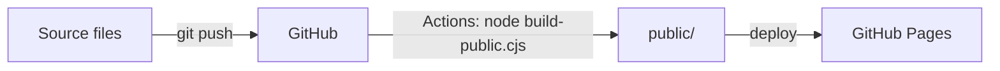

# Ding's working notes (site)

A small static site: a home page, a business analysis playbook told as a scroll story, notes on using AI, and a reading list.

Every push to `main` rebuilds the site and publishes it with GitHub Pages (see `.github/workflows/pages.yml`).

## Files

| File | What it is |
| --- | --- |
| `data-analytics-playbook.html` | Home page source. Written as an artifact page, so it has no doctype or `<head>`; the artifact host and the build add them. |
| `playbook.html`, `ai.html`, `reading.html` | The other three pages, as full HTML documents |
| `site.css` | Shared styles, light and dark |
| `site.js` | Shared behaviour; each part runs only on pages that have its elements |
| `icons.svg` | The line drawings, as one sprite |
| `favicon.svg` | Browser tab icon (used by the public build) |
| `covers/` | Book covers for the Reading page (Open Library and Amazon; Spreadsheet Modelling Best Practice has a drawn cover because none was published) |
| `build-public.cjs` | Builds `public/` |
| `public/` | Generated. Don't edit it by hand; rebuild instead |

## Build the public site

Needs Node.js only, no packages.

```bash
node build-public.cjs
```

The build:

1. Wraps the home page in a full HTML document and saves it as `public/index.html`.
2. Copies the other pages, adding a page description and the favicon to each.
3. Copies the styles, script, drawings and covers.

Every page links to the others with relative paths, so the folder works from any address.



## Preview locally

```bash
python -m http.server 8000 --directory public
```

Then open http://localhost:8000.

## Deploy

Push to `main`. The workflow builds `public/` and deploys it to GitHub Pages; `public/` itself is not committed. In the repository settings, Pages uses **GitHub Actions** as its source.

The same `public/` folder also works on any other static host, such as Netlify Drop or Cloudflare Pages.

## Before going public

- The site shows the full name Wong Ding Zhe and the job title. Everything else is generic.
- All figures are illustrative, for a made-up café chain. No employer names, internal systems or real results.
- Search engines will index the site once it is linked anywhere. To keep it out of search results, add `<meta name="robots" content="noindex">` to each page's `<head>`.
