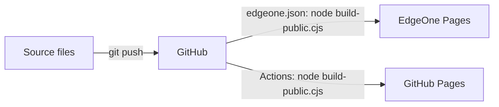

# Ding's working notes (site)

A small static site: a home page, a business analysis playbook told as a scroll story, a guide to using AI in six chapters, and a reading list.

Every push to `main` rebuilds the site and publishes it twice: to EdgeOne Pages at https://ba-working-notes.edgeone.dev (see `edgeone.json`), and to GitHub Pages (see `.github/workflows/pages.yml`).

This repository is the only copy of the site. A private claude.ai artifact of it is published from the same source files: https://claude.ai/artifact/RWmgt2EE3CVpYQ51yaWVv6

## Files

| File | What it is |
| --- | --- |
| `data-analytics-playbook.html` | Home page source. Written as an artifact page, so it has no doctype or `<head>`; the artifact host and the build add them. |
| `playbook.html`, `reading.html` | The playbook and the reading list, as full HTML documents |
| `ai.html` | Using AI: the guide's contents page, with the six chapters and my current tools |
| `ai-learn.html`, `ai-brief.html`, `ai-check.html`, `ai-delegate.html`, `ai-value.html`, `ai-analytics.html` | Using AI chapters 1 to 6, one page each: learn what AI can do, brief and steer the work, check the work, divide and delegate, judge whether it's worth it, and AI in analytics. |
| `site.css` | Shared styles, light and dark |
| `site.js` | Shared behaviour; each part runs only on pages that have its elements |
| `icons.svg` | The line drawings, as one sprite |
| `favicon.svg` | Browser tab icon (used by the public build) |
| `covers/` | Book covers for the Reading page, from Open Library, Amazon and Douban, resized to about 350 pixels wide. Spreadsheet Modelling Best Practice has a drawn cover in the page because none was published. |
| `build-public.cjs` | Builds `public/` |
| `AGENTS.md` | Maintenance notes: the decisions behind the writing, layout, visuals and build. `CLAUDE.md` points Claude Code to it. |
| `edgeone.json` | EdgeOne Pages settings: build command, output folder, and redirects from the old `.html` addresses. These override the console's build settings. |
| `zh/` | The Chinese version: the same pages with the same file names, in Simplified Chinese. They link one folder up for styles, script, icons and covers. |
| `fonts/` | `noto-sans-sc.woff2`, the Chinese web font trimmed to the characters the site uses, and its licence (`OFL.txt`) |
| `tools/subset-zh-font.py` | Remakes the trimmed Chinese font. See "Chinese font" below |
| `tools/check-translations.py` | Checks that each Chinese page has the same structure as its English twin (blocks, ids, citations, links). Run before committing. |
| `docs/zh-style-guide.md` | How the Chinese pages are written: style, translationese to avoid, and the fixed terms |
| `public/` | Generated. Don't edit it by hand; rebuild instead |

## Build the public site

Needs Node.js only, no packages.

```bash
node build-public.cjs
```

The build:

1. Wraps the home page in a full HTML document and saves it as `public/index.html`, and does the same for the Chinese pages in `zh/` (saved under `public/zh/`, with `lang="zh-CN"` and Chinese descriptions).
2. Copies the other pages, adding a page description, the favicon and the Umami analytics script (cookie-free) to each.
3. Copies the styles, script, drawings and covers. `site.css`, `site.js` and `icons.svg` get a fingerprint of their contents in the file name (for example `site.3de56787ab.css`), and every page links to those names. A changed file always has a new address, so phones and CDNs can't pair a new page with an old stylesheet. The plain names are written as well, so a page cached from before still finds its files.
4. Rewrites the links between pages to clean addresses: `./` for home, `playbook` instead of `playbook.html`, and so on.

GitHub Pages tells browsers to keep each page for 10 minutes, and that can't be changed. Right after a deploy, the GitHub Pages copy can show the previous version for up to 10 minutes, but always as a matching set. EdgeOne asks browsers to check for a new page every time.

The source pages keep their `.html` links so they still work when opened from disk. The public site uses clean addresses (`/playbook`, `/ai`, `/reading`), which EdgeOne, GitHub Pages, Netlify and Cloudflare Pages all serve from the matching `.html` file. On EdgeOne, `edgeone.json` sends the old `.html` addresses to the clean ones with a permanent (301) redirect, so links shared earlier keep working.



## Chinese font

The Chinese pages use Noto Sans SC (Source Han Sans), the Chinese companion to Source Sans. Google Fonts doesn't load in mainland China, so the site serves its own copy, trimmed to the characters the Chinese pages and `site.js` use (about 300KB for every weight from light to bold). The build fingerprints it like the other files.

After adding Chinese text, remake it, or new characters show in the reader's system font:

1. Download `NotoSansSC[wght].ttf` (about 18MB) once from https://github.com/google/fonts/tree/main/ofl/notosanssc. Keep it outside the repo.
2. Create the project's virtual environment once, then run the script:

```bash
python -m venv .venv
.venv/Scripts/python -m pip install fonttools brotli
.venv/Scripts/python tools/subset-zh-font.py path/to/NotoSansSC[wght].ttf
```

The font is under the SIL Open Font License; `fonts/OFL.txt` travels with it.

## Preview locally

The clean addresses need a server that maps `/playbook` to `playbook.html`. Python's built-in server doesn't, so use `serve`:

```bash
npx serve public
```

Then open http://localhost:3000.

## Deploy

Push to `main`. EdgeOne Pages and the GitHub Pages workflow each build `public/` and deploy it; `public/` itself is not committed. In the repository settings, Pages uses **GitHub Actions** as its source.

The same `public/` folder also works on any other static host, such as Netlify Drop or Cloudflare Pages.

## Before going public

- The top bar shows the site name, Ding's working notes. Each footer shows the full name Wong Ding Zhe with an email address and a LinkedIn link. Everything else is generic.
- All figures are illustrative, for a made-up café chain. No employer names, internal systems or real results.
- Search engines will index the site once it is linked anywhere. To keep it out of search results, add `<meta name="robots" content="noindex">` to each page's `<head>`.
