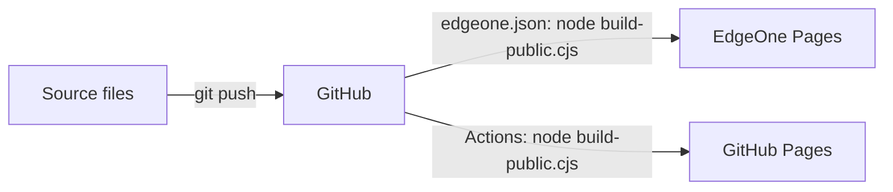

# Ding's working notes (site)

A small static site: a home page, a business analysis playbook told as a scroll story, notes on using AI, and a reading list.

Every push to `main` rebuilds the site and publishes it twice: to EdgeOne Pages at https://ba-working-notes.edgeone.dev (see `edgeone.json`), and to GitHub Pages (see `.github/workflows/pages.yml`).

This repository is the only copy of the site. A private claude.ai artifact of it is published from the same source files: https://claude.ai/artifact/RWmgt2EE3CVpYQ51yaWVv6

## Files

| File | What it is |
| --- | --- |
| `data-analytics-playbook.html` | Home page source. Written as an artifact page, so it has no doctype or `<head>`; the artifact host and the build add them. |
| `playbook.html`, `ai.html`, `reading.html` | The other three pages, as full HTML documents |
| `site.css` | Shared styles, light and dark |
| `site.js` | Shared behaviour; each part runs only on pages that have its elements |
| `icons.svg` | The line drawings, as one sprite |
| `favicon.svg` | Browser tab icon (used by the public build) |
| `covers/` | Book covers for the Reading page (Open Library and Amazon; Spreadsheet Modelling Best Practice has a drawn cover because none was published) |
| `build-public.cjs` | Builds `public/` |
| `edgeone.json` | EdgeOne Pages settings: build command, output folder, and redirects from the old `.html` addresses. These override the console's build settings. |
| `public/` | Generated. Don't edit it by hand; rebuild instead |

## Build the public site

Needs Node.js only, no packages.

```bash
node build-public.cjs
```

The build:

1. Wraps the home page in a full HTML document and saves it as `public/index.html`.
2. Copies the other pages, adding a page description and the favicon to each.
3. Copies the styles, script, drawings and covers. `site.css`, `site.js` and `icons.svg` get a fingerprint of their contents in the file name (for example `site.3de56787ab.css`), and every page links to those names. A changed file always has a new address, so phones and CDNs can't pair a new page with an old stylesheet. The plain names are written as well, so a page cached from before still finds its files.
4. Rewrites the links between pages to clean addresses: `./` for home, `playbook` instead of `playbook.html`, and so on.

GitHub Pages tells browsers to keep each page for 10 minutes, and that can't be changed. Right after a deploy, the GitHub Pages copy can show the previous version for up to 10 minutes, but always as a matching set. EdgeOne asks browsers to check for a new page every time.

The source pages keep their `.html` links so they still work when opened from disk. The public site uses clean addresses (`/playbook`, `/ai`, `/reading`), which EdgeOne, GitHub Pages, Netlify and Cloudflare Pages all serve from the matching `.html` file. On EdgeOne, `edgeone.json` sends the old `.html` addresses to the clean ones with a permanent (301) redirect, so links shared earlier keep working.



## Preview locally

The clean addresses need a server that maps `/playbook` to `playbook.html`. Python's built-in server doesn't, so use `serve`:

```bash
npx serve public
```

Then open http://localhost:3000.

## Deploy

Push to `main`. EdgeOne Pages and the GitHub Pages workflow each build `public/` and deploy it; `public/` itself is not committed. In the repository settings, Pages uses **GitHub Actions** as its source.

The same `public/` folder also works on any other static host, such as Netlify Drop or Cloudflare Pages.

## Before going public

- The site shows the full name Wong Ding Zhe and the job title. Everything else is generic.
- All figures are illustrative, for a made-up café chain. No employer names, internal systems or real results.
- Search engines will index the site once it is linked anywhere. To keep it out of search results, add `<meta name="robots" content="noindex">` to each page's `<head>`.
